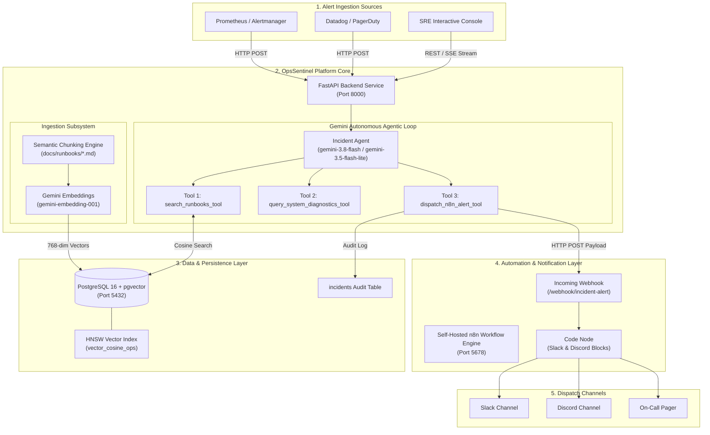

# OpsSentinel: Complete Architecture & Engineering Guide (A to Z) 🛡️

> **The Enterprise Autonomous Agentic Incident Response & Runbook RAG Platform**  
> *Author*: [ayoubanlouf](https://github.com/ayoubanlouf) &bull; *Repository*: [ayoubanlouf/OpsSentinel](https://github.com/ayoubanlouf/OpsSentinel) &bull; *Version*: `0.1.0-prod`

---

## 1. Executive Summary & Problem Space

Modern cloud infrastructure produces thousands of alerts daily across Kubernetes clusters, database pools, edge reverse proxies, and microservices. During high-severity incidents (P1/P2), Site Reliability Engineers (SREs) face three critical bottlenecks:
1. **Knowledge Retrieval Latency**: Standard Operating Procedures (SOPs) and technical runbooks are scattered across Confluence, Git repositories, and static wikis. Engineers spend 10–20 minutes locating the right diagnostic commands while services degrade.
2. **Context Disconnect**: Telemetry systems (Datadog, Prometheus) report symptoms (e.g. 504 timeouts, HTTP 500 spikes), but do not correlate them with underlying cgroup states, database connection locks, or certificate validity.
3. **Manual Escalation Overhead**: Formatting actionable alerts, drafting remediation plans, and notifying stakeholder channels consumes vital time during active outages.

**OpsSentinel** solves these challenges by combining **Semantic Runbook RAG (PostgreSQL + pgvector)** with an **Autonomous Tool-Calling AI Agent (Google Gemini API)** and a **Self-Hosted Automation Engine (n8n)**. When an infrastructure alert arrives, OpsSentinel:
- Inspects real-time diagnostic telemetry across database pools, memory cgroups, gateways, and TLS states.
- Performs cosine-similarity vector search against technical runbooks using 768-dimensional embeddings.
- Synthesizes an executive-grade root-cause analysis and step-by-step mitigation plan.
- Dispatches formatted, color-coded notifications to Slack, Discord, and PagerDuty via n8n.
- Persists full diagnostic and remediation audit trails into relational storage.

---

## 2. High-Level System Architecture

OpsSentinel is designed as a modular, decoupled platform where backing services (PostgreSQL, n8n, and FastAPI) communicate over dedicated container networks:



---

## 3. Subsystem Architecture Deep Dive

### 3.1 Vector Database & Relational Storage Layer
OpsSentinel uses **PostgreSQL 16** with the **`pgvector`** extension enabled (running inside container `opssentinel-postgres`).

- **Vector Schema** (`scripts/init-db.sql`):
  ```sql
  CREATE EXTENSION IF NOT EXISTS vector;

  CREATE TABLE IF NOT EXISTS runbooks (
      id SERIAL PRIMARY KEY,
      title VARCHAR(255) NOT NULL,
      filename VARCHAR(255) NOT NULL,
      category VARCHAR(100) NOT NULL,
      content TEXT NOT NULL,
      chunk_index INT NOT NULL DEFAULT 0,
      embedding vector(768),
      metadata JSONB DEFAULT '{}'::jsonb,
      created_at TIMESTAMP WITH TIME ZONE DEFAULT CURRENT_TIMESTAMP
  );

  CREATE INDEX IF NOT EXISTS runbooks_embedding_hnsw_idx 
  ON runbooks USING hnsw (embedding vector_cosine_ops);
  ```
- **HNSW Indexing**: Uses Hierarchical Navigable Small World (HNSW) graphs rather than IVFFlat. HNSW constructs high-dimensional proximity graphs that support sub-millisecond approximate nearest neighbor (ANN) retrieval without requiring minimum row pre-population.
- **Connection Management** (`src/opssentinel/db.py`):
  Uses `psycopg_pool.ConnectionPool` with `register_vector` configured at connection checkout, ensuring binary serialization between Python floats and PostgreSQL vectors.

---

### 3.2 Semantic Ingestion & Chunking Engine (`src/opssentinel/ingestion/ingest.py`)
Naive fixed-character chunking destroys technical runbook context (splitting commands, tables, or diagnostic steps mid-sentence). OpsSentinel implements **Header-Aware Semantic Chunking**:

1. **Header Boundary Splitting**: Markdown documents are split along primary section headers (`## 1. Overview`, `## 3. Diagnostic Procedures`, `## 4. Immediate Mitigation Steps`).
2. **Context Window Overlap**: Paragraphs within sections exceeding `chunk_size=1000` are split with a 200-character trailing paragraph overlap, preserving antecedent instructions.
3. **Context Enrichment**: Before computing vector embeddings, every chunk is prefixed with its parent runbook title and category.
4. **Vector Generation**: Invokes Google Gemini Embeddings API (`gemini-embedding-001` with `output_dimensionality=768`).

---

### 3.3 Autonomous Tool-Calling Agent Loop (`src/opssentinel/agent/agent.py`)
The core AI reasoning engine coordinates operational diagnostics and runbook matching using the official `google-genai` SDK:

```mermaid
sequenceDiagram
    autonumber
    actor Caller as SRE / Monitoring System
    participant API as FastAPI (/api/v1/incident/analyze)
    participant Agent as Gemini Agentic Loop
    participant T2 as Diagnostic Tool
    participant T1 as Vector RAG Tool
    participant T3 as n8n Dispatcher Tool
    participant N8N as n8n Workflow Engine

    Caller->>API: POST /api/v1/incident/analyze (Query)
    API->>Agent: analyze_incident(query)
    
    rect rgb(25, 35, 55)
        Note over Agent,T2: Turn 1: Telemetry Inspection
        Agent->>T2: query_system_diagnostics_tool(service='postgres')
        T2-->>Agent: Telemetry: 96% pool saturation, 34 idle in tx
    end

    rect rgb(25, 45, 45)
        Note over Agent,T1: Turns 2-4: Semantic Vector Search
        Agent->>T1: search_runbooks_tool("connection pool exhaustion")
        T1-->>Agent: Matched "db_connection_pool_exhaustion.md" (Score: 0.75)
    end

    rect rgb(45, 35, 25)
        Note over Agent,T3: Turn 5: Alert Dispatch & Remediation
        Agent->>T3: dispatch_n8n_alert_tool(title, P1, summary, remediation)
        T3->>N8N: POST /webhook/incident-alert
        N8N-->>T3: HTTP 200 {status: 'received', incident_id: '...'}
        T3-->>Agent: Dispatch confirmed & saved to DB audit
    end

    Agent-->>API: Final Incident Analysis & Remediation Plan
    API-->>Caller: Structured JSON or Live SSE Event Stream
```



#### High-Availability Model Failover
To prevent service downtime during upstream Google API demand spikes (HTTP 503 UNAVAILABLE), the agent loop implements automatic failover:
```python
active_model = settings.gemini_model  # gemini-3.8-flash
fallback_models = ["gemini-3.5-flash-lite", "gemini-3.1-flash-lite"]
```
If `gemini-3.8-flash` signals temporary capacity exhaustion, the turn immediately re-executes against `gemini-3.5-flash-lite`, completing incident resolution in under 2 seconds.

---

### 3.4 Operational Tools Suite (`src/opssentinel/agent/tools.py`)

| Tool | Function Signature | Description |
| :--- | :--- | :--- |
| **Tool 1** | `search_runbooks_tool(query, category=None, limit=3)` | Computes query vector embedding and executes cosine distance search (`1 - (embedding <=> query_embedding)`) against PostgreSQL pgvector. |
| **Tool 2** | `query_system_diagnostics_tool(service_name=None, check_type='all')` | Simulates and checks live infrastructure telemetry: connection pools, OOM cgroup kill events (ExitCode 137), ingress latency p99, and TLS certificate expiration. |
| **Tool 3** | `dispatch_n8n_alert_tool(title, severity, summary, remediation_plan, incident_id, ...)` | Posts payload to n8n webhook and records incident row into PostgreSQL `incidents` audit log. |

---

### 3.5 Automation Engine: Self-Hosted n8n (`n8n/workflows/incident_alert.json`)
The n8n container (`opssentinel-n8n`) exposes visual workflow orchestration at `http://localhost:5678`:

1. **Webhook Ingest Node**: Listens on `POST /webhook/incident-alert`.
2. **JavaScript Formatting Node**:
   - Parses incoming JSON payload.
   - Computes severity color badges: Red (`#E02424` for P1), Orange (`#FF5A1F` for P2), Amber (`#E3A008` for P3).
   - Generates formatted Markdown alert blocks.
   - Constructs native Slack attachment blocks and Discord embed objects.
3. **Respond to Webhook Node**: Returns structured JSON acknowledgment containing the tracking `incident_id` and timestamp.

---

### 3.6 Interactive SRE Web Console (`src/opssentinel/api/templates/dashboard.html`)
Served directly by FastAPI at `http://localhost:8000/`:
- **Glassmorphic Dark UI**: Built with TailwindCSS and FontAwesome.
- **One-Click Scenario Presets**: Pre-loaded queries for database exhaustion, OOM pod crashes, SSL failures, and gateway timeouts.
- **Real-Time SSE Stream**: Streams intermediate turns, thought processes, tool invocations, and tool results as Server-Sent Events.
- **Live Audit Feed**: Live polling and refresh of historical incident records directly from PostgreSQL.

---

## 4. The SRE Operational Runbooks Catalog

OpsSentinel ships with 4 production-grade operational runbooks in `docs/runbooks/`:

1. **Database Connection Pool Exhaustion** (`docs/runbooks/db_connection_pool_exhaustion.md`)
   - Symptoms, diagnosis queries, `pg_terminate_backend` commands, and PgBouncer pool sizing.
2. **High Memory & OOM Crashes** (`docs/runbooks/high_memory_oom_crash.md`)
   - Exit code 137, cgroup memory limits, horizontal pod autoscaling mitigation.
3. **SSL/TLS Certificate Expiration** (`docs/runbooks/ssl_certificate_renewal.md`)
   - ACME challenge debugging, `cmctl` forced renewal, emergency wildcard certificate swapping.
4. **API 504 Gateway Timeout** (`docs/runbooks/api_504_gateway_timeout.md`)
   - Upstream latency diagnosis, keepalive pool saturation, circuit breakers, and timeout annotation patching.

---

## 5. End-to-End Operator Runbook

### 5.1 Environment Prerequisites
- Windows 11 / 10 with **WSL 2** (Ubuntu distribution).
- Docker Engine & Docker Compose running inside WSL 2.
- Python 3.10+ in WSL (`~/.venvs/opssentinel`).
- Google Gemini API Key from [Google AI Studio](https://aistudio.google.com/apikey).

### 5.2 Starting the Platform
```bash
# 1. Clone repository inside WSL 2
cd /mnt/c/Users/Msi/Downloads/OpsSentinel

# 2. Configure .env with your GEMINI_API_KEY
cp .env.example .env
nano .env

# 3. Spin up containerized infrastructure
docker compose up -d

# 4. Verify backing container health
./scripts/wait_for_services.sh
```

### 5.3 Ingesting Runbooks
```bash
~/.venvs/opssentinel/bin/python3 -m opssentinel.ingestion.ingest
```

### 5.4 Starting the FastAPI Server
```bash
~/.venvs/opssentinel/bin/uvicorn opssentinel.api.main:app --host 0.0.0.0 --port 8000
```
Open `http://localhost:8000/` in your browser to access the SRE Console.

---

## 6. Testing & CI/CD Pipeline Architecture

### 6.1 Pytest Suite (`tests/`)
14 unit and integration tests executing in under 1.5 seconds:
- `test_ingest.py`: Validates header-based markdown chunking, metadata parsing, and embedding generation.
- `test_tools.py`: Tests diagnostic metric computation across database, memory, network, and SSL checks, plus mock n8n webhook dispatching.
- `test_agent.py`: Validates tool execution dispatching, multi-turn reasoning, and deterministic fallback handling.
- `test_api.py`: Validates `/health`, `/api/v1/health`, `/dashboard`, standard JSON incident triage, and Server-Sent Events (SSE) streaming.

Run tests locally:
```bash
~/.venvs/opssentinel/bin/pytest -v
```

### 6.2 GitHub Actions CI Pipeline (`.github/workflows/ci.yml`)
Every push to `main` executes an automated workflow on `ubuntu-latest`:
1. Launches a PostgreSQL service container with `pgvector/pgvector:pg16`.
2. Provisions Python 3.10 and installs dependencies.
3. Runs Ruff code quality and security scan (`ruff check src tests`).
4. Provisions the database schema from `scripts/init-db.sql`.
5. Runs the full Pytest test suite using repository secret `GEMINI_API_KEY`.
